# 🐻 Hi, I'm BearDad 🐻

&nbsp;**_About me_** 

Embedded and machine-vision developer from Spain. C++ on microcontrollers by day, Linux tinkering by night.

- 🔧 **Work:** ESP32 firmware in C++ (PlatformIO), stepper motion control, MQTT, OpenCV pipelines with industrial cameras
- ⚡ **Background:** industrial automation and robotics: wiring, control panels, PCB design
- 🌱 **Learning:** modern C++, Go, computer vision
- 🎯 **Heading to:** low-level systems, FPGA and HPC
- 🐧 **Setup:** Arch + Hyprland + Neovim + fish ([dotfiles](https://github.com/BearDad/.dotfiles))
- 👯 Happy to collaborate on open source

## 🧰 Toolbox

**Languages** 
&nbsp;
&nbsp;
&nbsp;
&nbsp;
&nbsp;
&nbsp;

**Embedded & vision** 
&nbsp;
&nbsp;
&nbsp;
&nbsp;
&nbsp;

**Tools** 
&nbsp;
&nbsp;
&nbsp;
&nbsp;
&nbsp;
&nbsp;
&nbsp;
&nbsp;

## 📈 Activity

  
  

<picture>
  <source media="(prefers-color-scheme: dark)" srcset="https://raw.githubusercontent.com/BearDad/BearDad/output/snake-dark.svg" />
  <source media="(prefers-color-scheme: light)" srcset="https://raw.githubusercontent.com/BearDad/BearDad/output/snake.svg" />
  
</picture>

## 🤝 Connect

&nbsp;
&nbsp;
&nbsp;
&nbsp;
